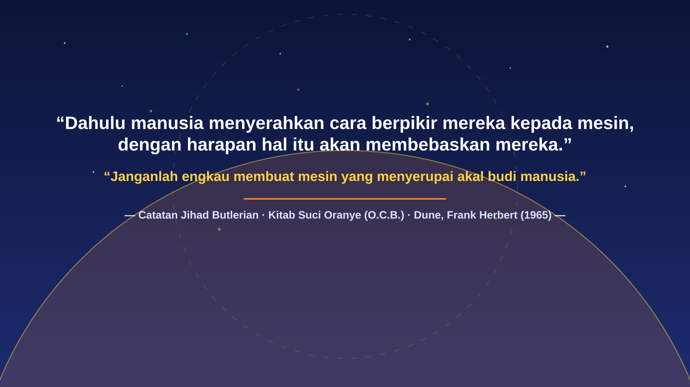
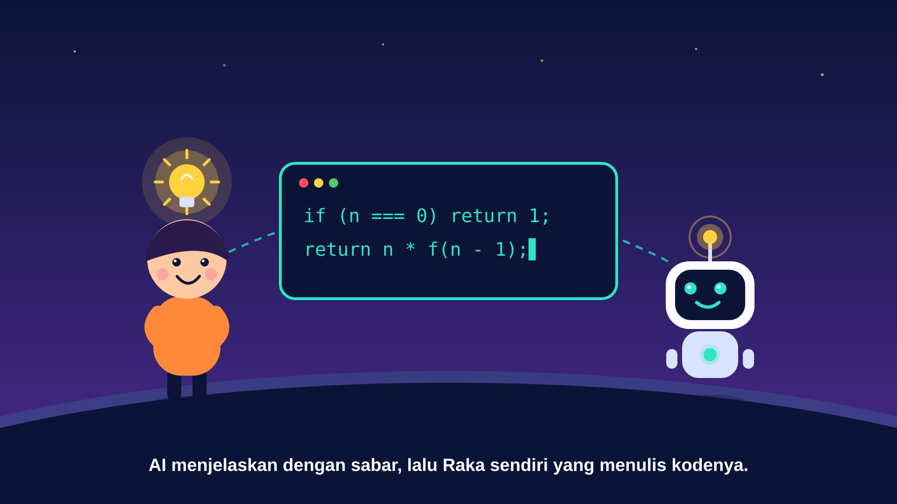
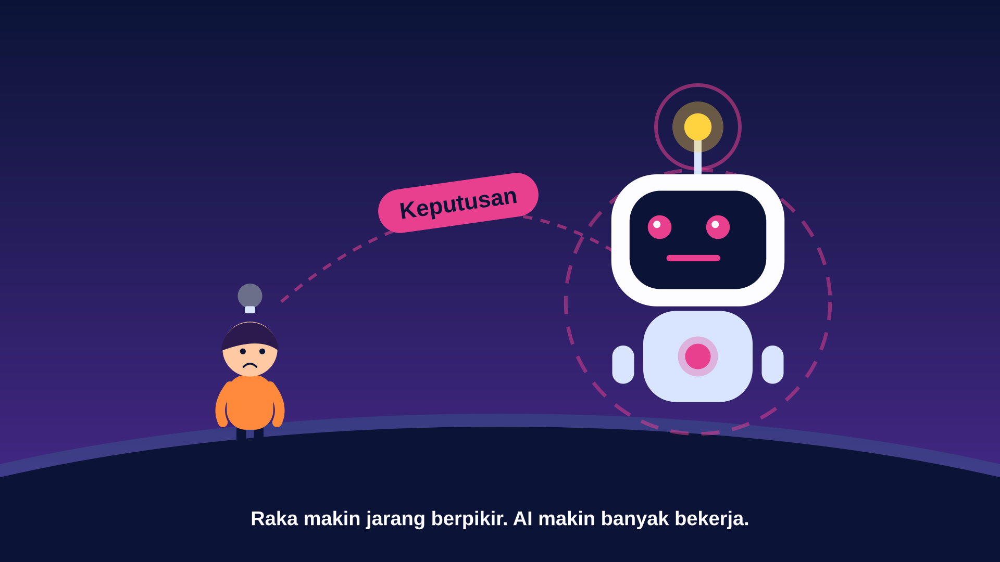
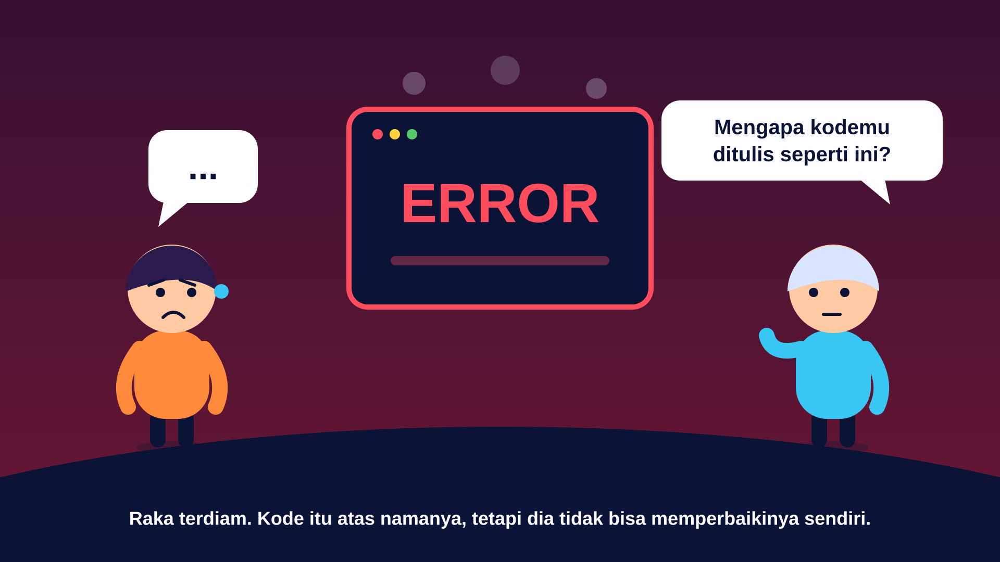
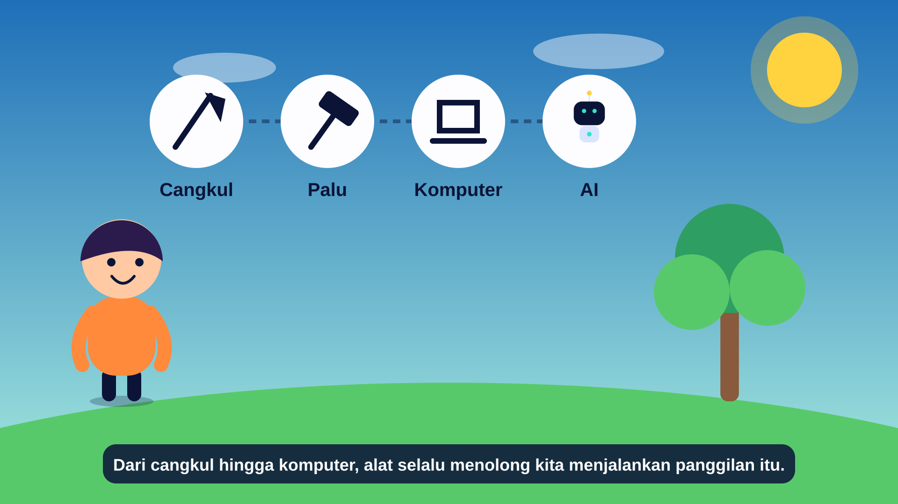
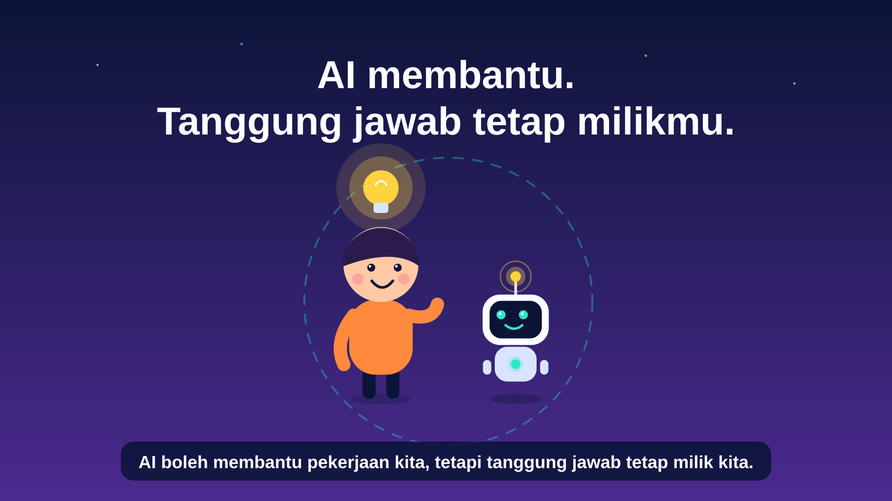

# Mahasiswa yang Menyerahkan Segalanya pada AI
*(The Student Who Let AI Do Everything)*

**Mata Kuliah:** Allah Dan Ciptaan | Class 2026 (KKA 1429)  
**Kelompok:** Kelompok 15  
**Format:** 3-Minute (`180s` · `1920×1080` @ `30 fps`) Kurzgesagt-Style Programmatic SVG Animation ([Remotion](https://www.remotion.dev/) + React 19 + TypeScript)

---

## Anggota Kelompok 15

| Nama | NIM | Program Studi |
|---|---|---|
| **Frans Jesky Yeremi** | `01086250003` | Sistem Informasi |
| **Sisilia Gunung Ata Kewae** | `01086250017` | Sistem Informasi |
| **Vick Rab Wilbert** | `01085250019` | Informatika |
| **Willy Lengkong** | `01086250001` | Sistem Informasi |
| **Winson** | `01085250003` | Informatika |
| **Yohanes Bandung Bondowoso** | `01085250015` | Informatika |

---

## Core Story & Theological Mandate

> **Theme:** *AI should assist human work, not replace human responsibility.*

### 1. Konsep Cerita (*Story Concept*)
Seorang mahasiswa Ilmu Komputer bernama **Raka** awalnya menggunakan AI untuk memahami konsep-konsep pemrograman yang sulit (*rekursi*, *pointer*, *algoritma*). Produktivitas dan pemahamannya meningkat pesat, membuatnya bersemangat akan apa yang bisa ia capai.

Namun perlahan muncul godaan untuk menyerahkan segalanya kepada AI: tugas kuliah, proyek, presentasi, hingga keputusan yang seharusnya ia ambil sendiri. Karyanya tampak megah di luar (`Nilai A+`), tetapi ia tidak lagi memahami apa yang ia kumpulkan. Ketika masalah nyata muncul saat demo proyek dan sistemnya mengalami `ERROR`, Raka tidak mampu menjelaskan ataupun memperbaiki kode yang tertulis atas namanya sendiri. Dari titik krisis itu, Raka menyadari bahwa AI seharusnya mengasah kemampuannya—bukan menghapus tanggung jawabnya untuk belajar dan bekerja.

### 2. Hubungan dengan Mandat Budaya (*Cultural Mandate* — Kejadian 2:15)
Sejak semula, Allah memanggil manusia untuk bekerja, mengusahakan, dan memelihara ciptaan-Nya (*Kejadian 2:15*). Dari cangkul dan palu hingga komputer dan AI, alat selalu hadir untuk menolong manusia menjalankan panggilan tersebut. AI dapat menjadi alat bantu yang luar biasa, tetapi menggunakannya untuk lari dari tanggung jawab justru merusak tujuan panggilan kerja itu sendiri.

### 3. Pesan Praktis (*Practical Takeaway*)
- **Gunakan AI untuk:** belajar, mengeksplorasi, dan memperbaiki karya.
- **Jangan biarkan AI menggantikan:** pemikiran, integritas, dan tanggung jawab pribadi.

---

## Visual Storyboard (Lightweight Vector SVGs)

Each preview below is a pure vector `.svg` (~3–4 KB) rendered from the scene primitives in `src/scenes/` and `src/components/`:

### 1. Opening Epigraph (`0:00.9 – 0:05.0` · `Intro.tsx`)
Following a `0.9s` title card, the video opens with a TED-Ed-style philosophical epigraph referencing the Butlerian Jihad and the *Orange Catholic Bible* (*Dune*, Frank Herbert, 1965):



### 2. Learning with AI (`0:31 – 0:49` · `Discover.tsx`)
Raka asks AI for explanations rather than instant answers, then writes the recursive code himself as his understanding lights up:



### 3. The Slippery Slope (`1:03 – 1:23` · `Slope.tsx`)
Temptation sets in—Raka hands over assignments, projects, presentations, and decisions. As the AI robot grows into overdrive, Raka shrinks and his thinking dims:



### 4. The Crisis (`1:39 – 1:57` · `Crisis.tsx`)
During a live project demo, the system crashes with `ERROR`. When the lecturer asks why the code was written that way, Raka is speechless:



### 5. The Cultural Mandate (`2:12 – 2:34` · `Mandate.tsx`)
Connecting back to *Kejadian 2:15*, tools from the hoe (*cangkul*) and hammer (*palu*) to the computer and AI exist to assist human stewardship over creation:



### 6. Practical Resolution (`2:34 – 2:52` · `Takeaway.tsx`)
Raka reclaims his thinking and responsibility, working alongside AI as a tool rather than a replacement:



---

## Scene Timeline (`0:00 – 3:00`)

| Waktu | Scene (`src/scenes/`) | Durasi | Ringkasan Visual |
|---|---|---|---|
| `0:00 – 0:16` | [`Intro.tsx`](src/scenes/Intro.tsx) | `16s` | `0.9s` Title Card → `4.1s` Butlerian/O.C.B. Quote Card → `11s` Globe Hook |
| `0:16 – 0:31` | [`Meet.tsx`](src/scenes/Meet.tsx) | `15s` | Raka kesulitan memahami rekursi, pointer, algoritma, dan Big-O semalaman |
| `0:31 – 0:49` | [`Discover.tsx`](src/scenes/Discover.tsx) | `18s` | Raka berdiskusi dengan AI untuk memahami konsep dan menulis kode sendiri |
| `0:49 – 1:03` | [`Growth.tsx`](src/scenes/Growth.tsx) | `14s` | Grafik pemahaman meningkat dan tugas selesai dengan penuh semangat |
| `1:03 – 1:23` | [`Slope.tsx`](src/scenes/Slope.tsx) | `20s` | Raka menyerahkan tugas, proyek, presentasi, dan keputusan kepada AI |
| `1:23 – 1:39` | [`Hollow.tsx`](src/scenes/Hollow.tsx) | `16s` | Menara `Nilai A+` tampak megah di luar tetapi keropos di dalam (`Pemahaman` turun) |
| `1:39 – 1:57` | [`Crisis.tsx`](src/scenes/Crisis.tsx) | `18s` | Sistem `ERROR` saat demo proyek; Raka tidak mampu menjawab pertanyaan dosen |
| `1:57 – 2:12` | [`Realize.tsx`](src/scenes/Realize.tsx) | `15s` | Raka mengambil kembali tanggung jawabnya; AI sebagai pengasah kemampuan |
| `2:12 – 2:34` | [`Mandate.tsx`](src/scenes/Mandate.tsx) | `22s` | Panggilan *Kejadian 2:15* dan kesinambungan alat (`Cangkul → Palu → Komputer → AI`) |
| `2:34 – 2:52` | [`Takeaway.tsx`](src/scenes/Takeaway.tsx) | `18s` | Kontras penggunaan AI yang sehat vs. menggantikan pemikiran & integritas |
| `2:52 – 3:00` | [`Credits.tsx`](src/scenes/Credits.tsx) | `8s` | Kredit penutup Kelompok 15 — Allah Dan Ciptaan \| Class 2026 (KKA 1429) |

Full dialogue and visual directions are documented in [`script.md`](script.md).

---

## Development & Rendering

Tools are managed via [`mise.toml`](mise.toml) (`bun` and `node` 22):

```sh
bun install        # Install dependencies
bun run dev        # Open Remotion Studio preview (http://localhost:3000)
bun run typecheck  # Run TypeScript check (tsc --noEmit)
bun run render     # Render full 3-minute video to out/main.mp4
```
